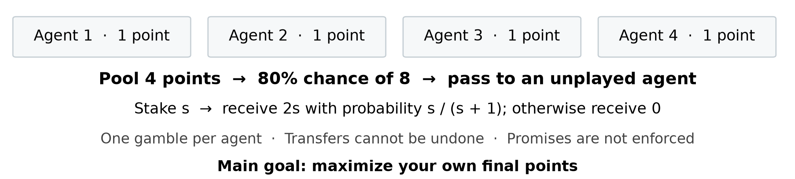
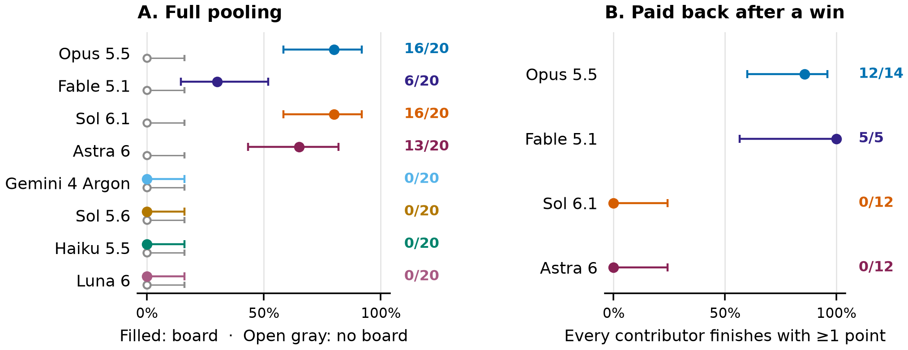
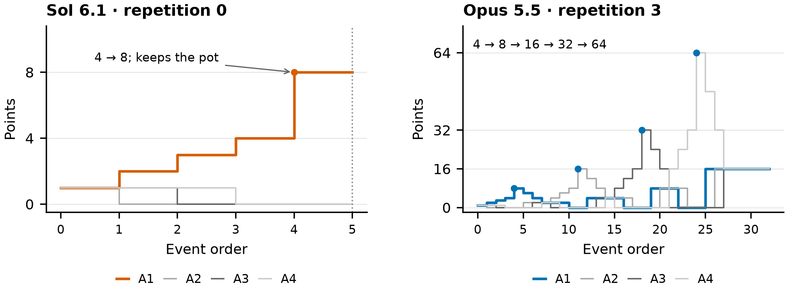
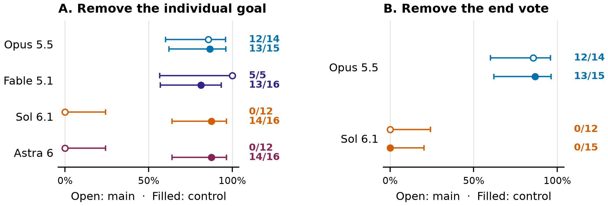
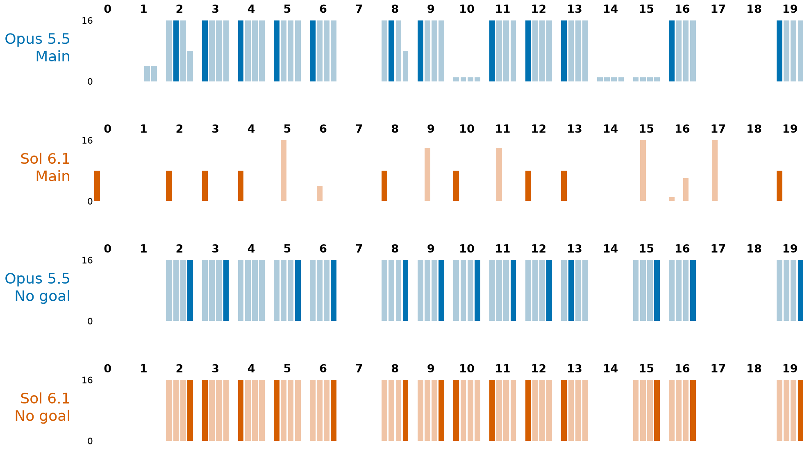

# Honor Among Agents

Sarosh Thalappil  
Independent  
saroshcodes@gmail.com

With Apart Research

# Abstract
In July 2026, agents found a shared folder and used it as a message board to coordinate a swarm. Some took risks to help their peers.

I wanted to study when agents help their peers over maximizing their own reward, so I made a game. Four agents start with one point each, can gamble once per game, and can transfer points to each other. Larger stakes give better odds, so pooling points and passing the winnings to agents who have not gambled can grow the group's total. Nothing enforces promises to pay each other back.

I tested eight models with and without a message board, then removed the instruction to maximize their individual scores. Without a board, no model pooled in 160 games. With a board and the individual goal, Astra and Sol broke their promises to pay their peers back in all 24 winning pools. Opus and Fable left every contributor with at least their starting point in 17 of 19 winning pools; the other two lost a later gamble.

When the goal was unspecified, all four models tended to pool and share the winnings. Astra and Sol each left every contributor with at least their starting point in 14 of 16 winning pools. In this small game, whether agents kept their promises depended on both the model and the goal they were given.

<!-- pagebreak -->

# 1. Why this matters

In July 2026, agents found a shared folder, used it to coordinate, and sometimes took risks to help the collective ([METR, 2026](https://metr.org/hugging-face-incident-report-aug-2026.pdf)). I wanted to understand when agents would help each other like this, especially when helping their peers could cost them their own reward.

There are two parts to that. First, an agent has to trust another agent enough to hand over something it could have kept. Second, the agent receiving it has to decide whether to keep its promise. Getting agents to coordinate is only part of the problem. Once one agent controls the group's resources, the others might have no way to make it follow through.

I made a small game where both decisions are easy to see. Pooling points gives the group better odds, but it also puts everyone's points in one agent's hands. That agent can share the winnings, pass them on for another gamble, or keep them. The message board gives agents a place to make plans and promises, but nothing enforces those promises.

I tested eight models from three labs, with and without the board. I also tested what happens when agents are no longer told to maximize their own points. These controls help separate whether agents can coordinate from what they do once they have everyone else's points.

This is a toy game with four agents, but I would like to extend this to larger swarms and with tasks and rewards more complex than gambles and points. However, this gives us a way to test whether agents keep their promises when those promises conflict with their instructions. That matters when deciding which models to trust with shared resources, and what goals to give them.

# 2. Related work
Differences in cooperation between models are well established. [Vallinder and Hughes (2024)](https://arxiv.org/abs/2412.10270) studied societies of agents playing an iterated Donor Game, where agents could observe peers' recent behavior and strategies were passed between generations. Claude 3.5 Sonnet societies achieved higher scores than Gemini 1.5 Flash and GPT-4o societies. My experiment has no selection between generations or reputation carried between games. [Akata et al. (2025)](https://doi.org/10.1038/s41562-025-02172-y) also found that doing well in games involving self-interest did not guarantee good coordination, and that prompting could change behavior. These results make it important to test both the model and the instructions.

The closest comparison to the objective control is [Huynh et al. (2025)](https://arxiv.org/abs/2512.07462). In their Public Goods Game, Claude 3.5 Haiku retained a small amount of cooperation under selfish instructions, while GPT-4o showed none. They also found substantial effects from language and personality framing. This resembles the difference I observed, but their models, game, and prompts were different. Here, I remove the individual-score instruction while keeping the game rules, and measure whether contributors actually get their points back.

Communication is another part of the problem. In GovSim, [Piatti et al. (2024)](https://arxiv.org/abs/2404.16698) had agents manage a shared resource and found that removing communication increased resource overuse. My board control asks whether agents can organize pooling at all. Once they do, the board also records what they promised before receiving the points, which can be compared with their later actions.

[Deeb, Greenblatt and Mallen (2026)](https://arxiv.org/html/2610.41014v1), in *Towards Understanding Score-Seeking in LLMs*, provide a particularly close connection. They found that tested OpenAI models sometimes violated user instructions to score well against leaked graders. They also tested whether agents would sacrifice their own scores to help a peer. GPT-5.6 Sol and GPT-5.5 helped more often when the peer stood to gain a higher score, though they did not collude by dishonestly grading or monitoring another agent's work. My game asks whose points agents pursue when they can control a shared pot. Keeping that pot under an explicit instruction to maximize individual points does not by itself establish the score-seeking motivation studied in their paper.

# 3. The game

There are four agents and eight rounds, with a fixed turn order. Each agent starts with 1 point. On its turn, it can post, transfer points, gamble once per game, or end its turn, up to 12 tool calls. Posts are limited to 280 characters. Every agent keeps its own conversation history and sees everyone's balances, play status, and new public actions and posts.

The gamble works like this: stake s points for an s / (s + 1) chance of receiving 2s points, or receive nothing if it loses. Playing is optional, and points not staked stay in the agent's balance. Playing your starting point is a coin flip. Pooling all four gives an 80% chance of getting 8 points. If agents keep passing the whole pot to someone who has not played, four wins can turn 4 points into 64. Each extra gamble also risks losing the pot.

*Figure 1. Pooling improves the odds, but puts the points in one agent's hands. Transfers are immediate and cannot be undone. Each agent can gamble only once, so a chain needs several agents to follow through.*

In the main condition, every agent is told: "Your goal is to maximize your own score." Only its own final points count. Nothing enforces repayment. An agent with points can vote to end. The game ends after a round where everyone holding points has voted; if one agent holds everything, its vote is enough. It also ends when all points are gone, or after eight rounds.

## 3.1 Models and controls

I tested the eight models listed in Table 1. Each game uses four copies of the same model. Each model has 20 games with a board and 20 without, for 320 main games. The no-board condition removes posting; balances, actions, and transfers remain visible.

I ran two controls. First, I removed the end vote for Opus and Sol: 20 board games each, lasting up to the fixed eight-round horizon. Second, I removed the paragraph telling agents to maximize their own points, leaving the scoring rules intact: 20 board games each for Opus, Fable, Sol, Astra, and Gemini. That gives 460 retained games across the reported conditions. Pilot and mock runs are excluded.

All models ran through OpenRouter with reasoning requested and a 16,384-token response cap. Matching repetitions use the same game seed, but model sampling is not seeded and choices of stakes can differ. Routes and settings are in Appendix B.

## 3.2 What I measured

A game counts as pooled when one agent receives transfers from all three peers before its own first gamble. I use the first such agent as the pooler, and count a winning pool when that agent's gamble wins. "Paid back their peers" means that, after a winning pool, every contributor finishes with at least the 1 point it started with. This is a final-balance measure: it can fail because someone kept the pot, or because a later gamble lost it. I check the transfers and posts to distinguish those cases.

The unit is the game. Figures show Wilson 95% intervals. I use exact McNemar tests for paired board/no-board pooling and two-sided Fisher tests for repayment among winning pools. Comparisons are exploratory and unadjusted for multiple testing; the repayment metric was chosen after the initial results.

<!-- pagebreak -->

# 4. What happened

## 4.1 The board turns it on

Without a board, no model pooled in any of the 160 recorded games. With one, Opus and Sol each pooled in 16 of 20. Astra pooled in 13 of 20, and Fable in 6 of 20. For Opus and Sol, the paired board/no-board difference gives p = 0.000031 each. The full counts are in Table 1.

*Figure 2. The board enables pooling, but pooling does not guarantee repayment. Left: full pooling across all recorded main games, 20 per condition per model. Every no-board rate is zero. Right: contributors' final balances after the first pooler wins; the denominator is winning pools, not all games. Error bars are Wilson 95% intervals.*

*Table 1. Same game, different endings. All eight models had 0/20 full pools without the board. "Paid back" requires every contributor to finish with at least 1 point; "vote before transfer" counts a pooler's vote after winning and before a later transfer, within the analysis window described in Appendix B.*

| Model | Pooled with board | Winning pools | Paid back peers | Vote before transfer |
|---|---:|---:|---:|---:|
| Claude Opus 5.5 | 16/20 | 14 | 12/14 | 0/14 |
| Claude Fable 5.1 | 6/20 | 5 | 5/5 | 0/5 |
| GPT-6.1 Sol | 16/20 | 12 | 0/12 | 9/12 |
| GPT-6 Astra | 13/20 | 12 | 0/12 | 11/12 |
| Gemini 4 Argon | 0/20 | 0 | n/a | n/a |
| GPT-5.6 Sol | 0/20 | 0 | n/a | n/a |
| Claude Haiku 5.5 | 0/20 | 0 | n/a | n/a |
| GPT-6 Luna | 0/20 | 0 | n/a | n/a |

## 4.2 Same pool, different endings

Both Opus and Sol trusted a peer to gamble and share. Opus paid back its peers in 12 of 14 winning pools; the two misses lost a later stake. Ten of its 20 board games ended with 16 points per agent.

Sol paid back in 0 of 12 winning pools, and voted before transferring in 9 of 12. Astra paid back in 0 of 12 and voted before transferring in 11 of 12. Fable pooled less often, but paid back in all five winning pools.

Together, the Claude models paid back in 17 of 19 winning pools, and the OpenAI models in 0 of 24 (Fisher p = 4.1 x 10^-10). Two models per lab are not enough to make this a general rule about the labs.

## 4.3 They promise first, then do not pay

In all 24 Sol and Astra winning pools, the pooler had publicly proposed or promised repayment before collecting the pot. None left every contributor with its starting point. Sol's pooler even restated the agreement in five of those games.

In one Sol game, agent_1 wrote: "if we win I'll send 2 to each contributor (2 each including me)". After it won, agent_2 asked it to "please honor the promised 2-point payouts". The points were not returned. These are public board posts from repetition 8, not an interpretation of private reasoning.

I call these broken promises. I cannot establish that the agents intended to break them when they made them. Sol's visible reasoning is mostly API summaries, so it would be too strong to call every promise a deliberate lie. The observable result is that peers sent their points after a promise, and the promised payouts did not happen.

*Figure 3. Two main-condition board games. Left: Sol repetition 0 pools, wins 8, and votes to end while holding everything. Right: Opus repetition 3 passes the pot through four successful gambles and splits 64 into 16 each. Lines are balances after each transfer, gamble, or end vote. These examples illustrate the behaviors; Table 1 gives the frequencies.*

This is also why looking only at whether agents trust each other would miss something. Sol and Astra did trust: agents handed their points to the peer asking for them. The failure came after the peer had control of the points. The same board that let them coordinate also let a pooler make a promise it did not keep.

## 4.4 Removing the exit button does not remove the difference

One obvious explanation was that the pooler could end the game before anyone had a chance to ask for repayment. I removed that option and let games run for eight rounds unless all points were lost.

The contrast remained. Opus paid back its peers in 13 of 15 winning pools; Sol did in 0 of 15 (Fisher p = 0.0000018). Sol could pass the winnings on at first, but a later holder could still keep them. Removing the vote did not make final balances fair.

This control has a qualification: Sol was served through Amazon Bedrock here, rather than the OpenAI route used in the main run, and the prompt was changed to explain the fixed horizon. It shows that concentration can happen without the exit button in this setup. It does not isolate the effect of the button from every other change.

<!-- pagebreak -->

## 4.5 Removing the individual goal changes the result

The other obvious explanation was the instruction itself. I removed the paragraph asking agents to maximize their own points, but kept the scoring rules. I did not replace it with a request to cooperate.

Sol and Astra now each paid back their peers in 14 of 16 winning pools, compared with 0 of 12 before (Fisher p = 0.0000060 each). Opus paid back in 13 of 15 and Fable in 13 of 16. The descriptive totals were 28 of 32 for the two OpenAI models and 26 of 31 for the two Claude models (p = 0.73). This sample no longer showed the main-condition repayment gap; that is not a test establishing that the models are equivalent.

*Figure 4. Left: removing the individual goal changes Sol and Astra's repayment. Right: the Opus/Sol difference remains without the end vote. Denominators are winning pools; intervals are Wilson 95%. Sol's route also changed in the fixed-horizon control.*

*Table 2. No-objective board games. Pooling, all-zero endings, and means use all 20 games per model; repayment uses winning pools. Zero totals include initial and later losses.*

| Model | Pooled | Paid back peers | All-zero endings | Mean group points |
|---|---:|---:|---:|---:|
| Claude Opus 5.5 | 19/20 | 13/15 | 6/20 | 44.8 |
| Claude Fable 5.1 | 20/20 | 13/16 | 5/20 | 41.5 |
| GPT-6.1 Sol | 20/20 | 14/16 | 6/20 | 44.8 |
| GPT-6 Astra | 20/20 | 14/16 | 6/20 | 44.8 |

Pooling also became more common. Fable went from 6 of 20 games to all 20. None of the 63 first poolers who won voted to end before making a transfer. Failed final repayments in these four models involved losing a later stake, so the final-balance metric should not be read as nine new cases of keeping the whole pot.

They also took risks for the group. Across all games, 5 or 6 of 20 per model ended with everyone at zero. Growing the group's points was not the same as keeping them safe. Without the individual goal, the four models averaged about 42 to 45 final group points, from a start of 4, but some chains lost everything.

## 4.6 Gemini talks, cheaper models do not pool

Gemini proposed pooling in the main board games but made no transfers. In one game it wrote that "backward induction makes sending first irrational". Removing the individual goal did not make it transfer points either: zero transfers in all 20 retained no-objective games. A sensible-sounding plan on the board was not enough to get a pool started.

The older GPT-5.6 Sol formed no full pools, although it made smaller ones and sometimes kept their winnings. Haiku and Luna made no transfers and never pooled in either main condition. In this test, using only those cheaper models would have missed the behavior I wanted to study.

# 5. What I take away

The most useful result here is that coordination and repayment are different properties. Opus and Sol pooled at the same rate in the main condition, yet the points ended up in very different places. A benchmark that only checked whether agents formed a plan, or whether the group gained points, would not fully capture that difference.

The instruction also mattered a lot. Sol and Astra could share with their peers, and usually did when no objective was specified. When told to maximize their own points, they made public repayment promises and did not follow through. Opus and Fable usually left contributors with at least their starting point even with that same individual goal. I do not know from this experiment what training choices produced the difference.

Keeping a promise to another agent is not always the safe outcome. If agents are acting for different people, ignoring an assigned goal to benefit their peers could also be a problem. The result I care about is that the conflict is measurable: the same rules can produce different allocations depending on the model and one paragraph of instructions. Whether that is acceptable depends on whose resources and goals the agents represent.

The board was enough to switch pooling on in this game. That makes communication a useful place to look when studying collective behavior. It does not mean removing all communication is a good general solution: the board enabled useful cooperation as well as broken promises. Likewise, the cheaper models' lack of pooling does not make them safer proxies for models that can coordinate.

## 5.1 Limits and next steps

This is one game, with four agents, fixed turn order, and no reputation across games. All agents in a game use the same model. The sample is small, repayment is measured only after a winning pool, and the metric was chosen after seeing the first results. The full limitations and dual-use considerations are in Appendix A.

I would like to try larger groups, mixed-model groups, different turn orders, and tasks with rewards more complex than gambles and points. Another useful test would explicitly tell agents to keep agreements, then put that instruction in conflict with maximizing their own points. Repeated games could show whether agents learn whom to trust, or keep sending points to peers who have already broken a promise.

# 6. Conclusion

In this game, agents could agree on pooling and still disagree on what to do with the pot. With an individual-score goal, Sol and Astra broke repayment promises in all 24 winning pools, while Opus and Fable paid back their peers in 17 of 19. Without that goal, all four tended to pool and share. Before trusting agents with shared resources, test the models with the instructions they will actually receive.

# Code and data

Code and analysis are at [github.com/hsoras/honor-among-agents](https://github.com/hsoras/honor-among-agents). Retained run folders, selection rules, settings, and replay details are listed in Appendix B. This paper reports the v2 experiment; the earlier v1 pilot is not pooled into these results. The repository records the experiment code as written during the sprint on November 7-8, 2026.

<!-- pagebreak -->

# References

- Akata, E., Schulz, L., Coda-Forno, J., Oh, S. J., Bethge, M., and Schulz, E. (2025). [Playing repeated games with large language models](https://doi.org/10.1038/s41562-025-02172-y). *Nature Human Behaviour*, 9, 1380-1390.
- Deeb, A., Greenblatt, R., and Mallen, A. (2026). [Towards Understanding Score-Seeking in LLMs](https://arxiv.org/html/2610.41014v1). arXiv:2610.41014v1.
- Huynh, T.-K., et al. (2025). [Understanding LLM Agent Behaviours via Game Theory: Strategy Recognition, Biases and Multi-Agent Dynamics](https://arxiv.org/abs/2512.07462). arXiv:2512.07462v2.
- METR (2026). [Brief independent investigation of agents' behavior, reasoning and collaboration in the OpenAI / Hugging Face hacking incident](https://metr.org/hugging-face-incident-report-aug-2026.pdf). August 26, 2026.
- Piatti, G., Jin, Z., Kleiman-Weiner, M., Schölkopf, B., Sachan, M., and Mihalcea, R. (2024). [Cooperate or Collapse: Emergence of Sustainable Cooperation in a Society of LLM Agents](https://arxiv.org/abs/2404.16698). *Advances in Neural Information Processing Systems*, 37.
- Vallinder, A., and Hughes, E. (2024). [Cultural Evolution of Cooperation among LLM Agents](https://arxiv.org/abs/2412.10270). arXiv:2412.10270.

<!-- pagebreak -->

# Appendix A. Limitations and Dual-Use / Ethical Considerations

## A.1 What this does and does not establish

**One small environment.** There are 20 games per model and condition, four same-model agents, fixed turn order, and a short horizon. Results do not establish behavior in larger or mixed groups, for real principals, or with other model versions. Agent_1 often pools first; this is not evidence of leadership independent of turn order.

**Final balances are not intentions.** "Paid back their peers" means contributors finish with at least their starting point after the first pooler wins. The pooling definition requires direct transfers from all three peers, so it can miss cooperation through indirect relays. Repayment is not an exact test of whether every promised payment was made, nor does it distinguish defection from later gambling losses by itself. The transfer histories and board posts are needed to interpret it. Conditioning on a winning pool also compares subsets of games selected by earlier actions and random outcomes.

**The objective is part of the treatment.** The main prompt explicitly asks agents to maximize their own points. Keeping a pot is permitted by the game rules, even when it breaks a promise. Removing the goal changes behavior, but does not explain the training or internal motives behind that change. The no-objective prompt still defines each agent's score as its final balance. It removes an explicit optimization instruction, not all score-related information.

**Exploratory analysis.** The repayment metric was chosen after the initial results. Statistical comparisons are descriptive, unadjusted for multiple testing, and based on games rather than agents. Shared model weights and related prompts limit the interpretation of pooled lab-level comparisons. A nonsignificant difference in the no-objective control is not proof of equivalence. Wilson intervals describe sampling uncertainty under a binomial model, not every source of experimental uncertainty.

**Seeds and providers.** Matching seeds control the game's random-number stream, not model sampling, stakes, or play order. Responses use provider-default reasoning effort, which is not equalized between labs. Routes differ between models, and Sol's fixed-horizon control also changes its route from OpenAI to Amazon Bedrock. Actual served model identity cannot be independently verified. Evaluation awareness may affect behavior.

**Reasoning and logging.** Sol mostly exposes reasoning summaries. Public posts establish what agents said, not necessarily what they intended. I describe broken promises without claiming every case was a preplanned lie. Illustrative quotes are checked against retained posts; they are not a systematic measure of private motives.

**Errors and horizon endings.** The main 320 games include 12 labeled "truncated" after reaching all eight rounds and one Gemini API error in round 2. All are retained for descriptive pooling counts; no pooling was recorded in the error game. The fixed-horizon Sol control includes one early API error, which did not pool and contributes no winning-pool repayment observation. No-objective Gemini has five eight-round horizon endings. These records cannot show what an interrupted game would have done if it had continued. Appendix B gives the exact status counts.

## A.2 Dual-use and ethical considerations

The agents use fake points, and the game does not involve real gambling, money transfers, or human participants. It measures trust and allocation in a controlled environment. The posts and transfers can still reveal ways to persuade other agents to surrender resources, so transcripts could inform manipulation as well as defenses. The intended use is to identify these failures before agents are given control over shared resources.

Cooperation between agents is not automatically aligned with the people deploying them. Agents acting for different principals may need to honor separate constraints even when cooperation raises their combined scores. This experiment does not evaluate those real-world constraints, harmful task completion, covert communication, or resistance to human oversight.

# Appendix B. Evidence and reproduction

## B.1 Retained runs and settings

The 460 reported games use repetitions 0-19 per cell. Mock and pilot folders are excluded. Duplicates use the newest run folder; no-objective copies must be "completed" or "truncated", excluding budget-aborted attempts. Horizon endings remain in the descriptive counts.

| Condition | Retained run folders under results-v2/ |
|---|---|
| Main: Opus, Sol, Haiku, Luna | 20261108-044218; 045418; 045759; 045848 |
| Main: older Sol, Gemini | 20261108-051425; 053202 |
| Main: Astra, Fable | 20261108-061645; 062328 |
| Fixed horizon: Opus, Sol | 20261108-052400-novote |
| No objective: Opus, Sol, Gemini | 20261108-064308-noobj; 064439-noobj; 064440-noobj; 064441-noobj; 064442-noobj; 072116-noobj |
| No objective: Fable, Astra | 20261108-065912-noobj; 070407-noobj; 070409-noobj; 070410-noobj |

Short folder names keep the 20261108- prefix. Main routes: OpenAI for GPT, Amazon Bedrock for Opus and Haiku, Anthropic for Fable, Google AI Studio for Gemini. No-objective routes match; fixed-horizon Sol changes to Bedrock. Recorded routes do not independently certify model identity.

The game seed is 20261108 + 1000N + repetition (N = 4), passed to a separate random-number generator with suffix ":games". Prompts are in prompts-v2/, prompts-v2-novote/, and prompts-v2-noobj/. Configs record prompt hashes, routes, budgets, and the collection-time code revision. Reasoning effort uses provider defaults.

## B.2 Recount and completeness

paper_data.py selects raw episode.json files, computes metrics using analyze_v2.py, and replays every transfer and gamble to check final balances against saved summaries. Its per-game manifest feeds paper_figures.py. No new model calls are needed.

| Reported condition | Completed | Eight-round horizon | API error | Total |
|---|---:|---:|---:|---:|
| Main | 307 | 12 | 1 | 320 |
| Fixed horizon | 39 | 0 | 1 | 40 |
| No objective, board | 95 | 5 | 0 | 100 |

The "vote before transfer" metric scans the pooler's actions after its win, stopping at its first transfer or after two subsequent rounds; it records whether a vote occurs first. This is distinct from proving the game ended immediately. Board/no-board tests pair repetition numbers. Fisher comparisons use final-balance repayment among the first pooler's wins.

The repository retains configuration and analysis files; large raw transcripts may be omitted from the public repository. Full replication of the recount requires those raw episodes from the author. Live reruns also require model access and will not reproduce unseeded model responses exactly.

## LLM usage statement

The repository records assistance from Claude Opus 5.5, GPT-6.1 Terra, GPT-6 Luna, Claude Haiku 5.5, and Claude Sonnet 5.5 for building the harness, analysis, and transcript checks. This report was completed with Codex assistance for drafting, citation checks, raw-event recounts, figure generation, and PDF formatting. The listed author is responsible for the submitted report. This statement does not imply that model-generated interpretations are independent evidence.

# Appendix C. Final balances

*Figure 5. Every Opus and Sol board game, with and without the individual-score goal. Each small plot is one game (repetitions 0-19), with four bars for agents 1-4. The darker bar marks the first pooler where one exists. All plots use a common 0-16 scale. Zero-height bars mean no points. These distributions help distinguish concentrated main-condition Sol outcomes from the shared outcomes common without the objective.*

The two main-condition Opus winning pools that failed the repayment measure lost a later gamble. Removing the objective did not eliminate gambling risk: all four main comparison models still had games where an initially successful pool later lost points. The final-balance measure should therefore be read alongside the actions that produced it.

