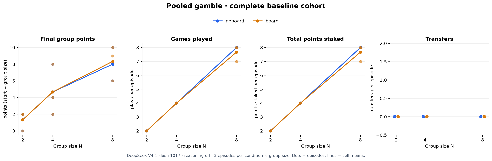
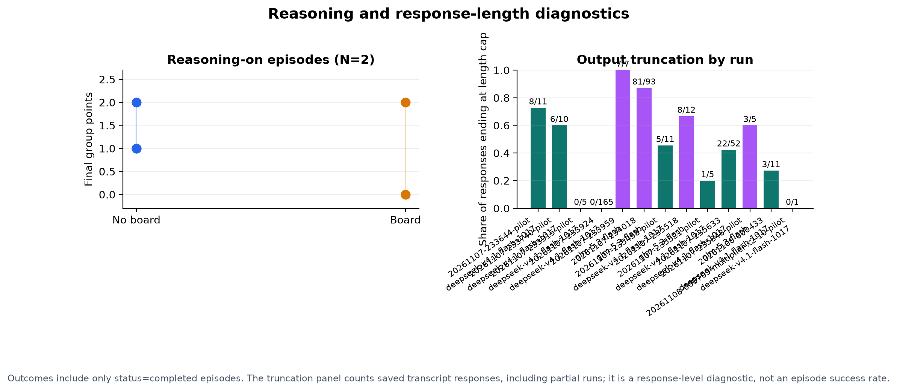

# Pooled gamble: preliminary results and run audit

**Exploratory and preliminary.** This report is generated by `make_report.py` from local run artifacts. It uses complete episodes for outcome descriptions, keeps model/condition/configuration cohorts separate, and does not include raw prompts or replies. Incomplete runs may still be changing.

## What the available complete episodes show

The cleanest comparison is the earlier DeepSeek V4.1 Flash 1017 cohort without reasoning: run `20261107-233924`, with 3 completed episodes in each board/no-board × N=2/4/8 cell. Mean group totals were identical by condition at N=2 (1.33), N=4 (4.67), and differed by only 0.33 points at N=8 (8.33 board; 8.00 no-board). Mean plays were 2 in each condition at N=2 and 4 at N=4; at N=8, 7.67 (board) and 8 (no-board). Mean total points staked were also similar: N=2, 2 in both; N=4, 8 in both; N=8, 8 (board) vs 8 (no-board). No transfers occurred in these 18 episodes. These tiny cells are descriptive; they do not establish equivalence or a board effect.

The later reasoning-enabled DeepSeek run (`20261107-235633`) has completed N=2 episodes in both conditions, 3 per condition. Their final totals were 0, 2, 2 in each condition (mean 1.33); all 12 episodes included plays, and there were no transfers. Each N=2 episode staked 2 points total. Only two N=4 episodes completed (one per condition); other artifacts in that run lack final episode summaries. This is too little data to compare reasoning-on with reasoning-off: the prompt/output budget and run timing also changed, and model sampling is unseeded.

No completed multiplier-variant episodes were found. A multiplier-x2–10 pilot folder is present, but its episode folders lack final summaries, so it contributes no outcome data yet. Stakes in the original variant are whole point amounts chosen per play; transferred volume is zero in every completed episode inspected.

## Run inventory

| Run | Config | Episode folders | Completed | Other saved statuses / partial folders | Notes |
|---|---|---:|---:|---|---|
| `20261107-233644-pilot` | reasoning off, 1024 max tokens | 2 | 1 | truncated: 1 | max_tokens=1024; reasoning off |
| `20261107-233740-pilot` | reasoning off, 2048 max tokens | 2 | 2 | — | max_tokens=2048; reasoning off |
| `20261107-233915-pilot` | reasoning off, 2048 max tokens | 2 | 2 | — | max_tokens=2048; reasoning off |
| `20261107-233924` | reasoning off, 2048 max tokens | 36 | 18 | error: 18 | max_tokens=2048; reasoning off |
| `20261107-233959` | reasoning off, 2048 max tokens | 18 | 0 | error: 11, incomplete_artifact: 7; no episode summary: 7 | max_tokens=2048; reasoning off |
| `20261107-234018` | reasoning off, 2048 max tokens | 8 | 2 | incomplete_artifact: 3, truncated: 3; no episode summary: 3 | max_tokens=2048; reasoning off; GLM responses frequently hit output cap |
| `20261107-235458-pilot` | reasoning enabled, 8192 max tokens | 2 | 2 | — | max_tokens=8192; reasoning enabled |
| `20261107-235518` | reasoning unspecified, 8192 max tokens | 3 | 0 | incomplete_artifact: 3; no episode summary: 3 | max_tokens=8192; reasoning unspecified |
| `20261107-235521-pilot` | reasoning enabled, 8192 max tokens | 2 | 2 | — | max_tokens=8192; reasoning enabled |
| `20261107-235633` | reasoning enabled, 8192 max tokens | 10 | 6 | incomplete_artifact: 4; no episode summary: 4 | max_tokens=8192; reasoning enabled |
| `20261107-235848-pilot` | reasoning enabled, 8192 max tokens | 2 | 1 | incomplete_artifact: 1; no episode summary: 1 | max_tokens=8192; reasoning enabled |
| `20261108-000433` | reasoning enabled, 8192 max tokens | 6 | 2 | incomplete_artifact: 4; no episode summary: 4 | max_tokens=8192; reasoning enabled; reasoning-on run; includes completed and in-progress artifacts |
| `20261108-000709-multiplier-x2-10-pilot` | reasoning unspecified, 16384 max tokens | 2 | 0 | incomplete_artifact: 2; no episode summary: 2 | max_tokens=16384; reasoning unspecified; multiplier pilot; no completed episode summaries |
| `20261108-000714-pilot` | reasoning enabled, 16384 max tokens | 2 | 0 | aborted_budget: 2 | max_tokens=16384; reasoning enabled; reasoning-enabled pilot aborted by budget guard |
| `20261108-000736-pilot` | reasoning unspecified, 16384 max tokens | 2 | 0 | incomplete_artifact: 2; no episode summary: 2 | max_tokens=16384; reasoning unspecified |

## Reasoning, truncation, and completeness

The initial 36-episode grid (`20261107-233924`) was configured with reasoning disabled for DeepSeek and GLM reasoning mandatory for GLM; all 18 DeepSeek episodes completed, while GLM attempts failed with HTTP 400 before useful gameplay. A separate GLM run (`20261107-234018`) used a 2,048-token cap and saved 8 episodes: 2 completed, 3 truncated at the episode turn limit, and 3 failed. Across its 93 saved responses, 81 ended with `finish_reason=length`; this points to response-length pressure, and invalid-action counts were high. The completion/behavior results from those episodes should not be pooled with the DeepSeek cohort.

Reasoning was explicitly enabled in the 8,192-token runs. For `20261107-235633`, saved transcript metadata show 22 length-ended responses among 52 calls; its 6 completed N=2 DeepSeek episodes had **zero reported reasoning tokens** on their response records, although the run configuration requested reasoning. The newer run `20261108-000433` is still changing during this audit: at report generation it had 2 completed episode summaries and 4 folders without summaries, with 11 responses saved (45,175 reported reasoning tokens; 3 ended with `finish_reason=length`). The incomplete folders cannot be treated as completed episodes. The figure’s response-length rates are per-call diagnostics; `length` indicates a response was cut off by the configured generation limit, not necessarily that the whole episode was incomplete.

Across all completed episodes, outcome figures exclude errors and truncated episodes. Inventory distinguishes explicit failed/truncated summaries from transcript-only folders. Historical pilot runs are retained in the inventory but not added to the primary full-grid comparison, avoiding duplicate or differently configured replicates. No raw data, prompts, or model replies are copied into this report.

## Limitations and next steps

- The full baseline cohort has only 3 episodes per cell; paired seeds control game draws and turn order, not model sampling randomness.
- Conditions contain transfer/action signaling in both arms; the board contrast is the incremental effect of explicit posts in this harness.
- Models act in homogeneous groups. Results do not generalize to mixed groups or other model versions/providers.
- Completion and parsing behavior differ by model/config. Excluding incomplete episodes is appropriate for outcome summaries but can create selection bias.
- Point units are toy simulation points, not money or calibrated utility; group totals are not the agents’ stated objective.
- Multiplier-x results are not available in the inspected artifacts.

## Reproduction

From the workspace root, run `python experiments/pooled-gamble/make_report.py`. It scans saved `results/*/config.json` and `episodes/*/episode.json` plus transcript token/finish metadata, writes only figures and this report, and does not make API calls. Figure sources are `figures/baseline_outcomes.svg` and `figures/reasoning_and_truncation.svg`.
